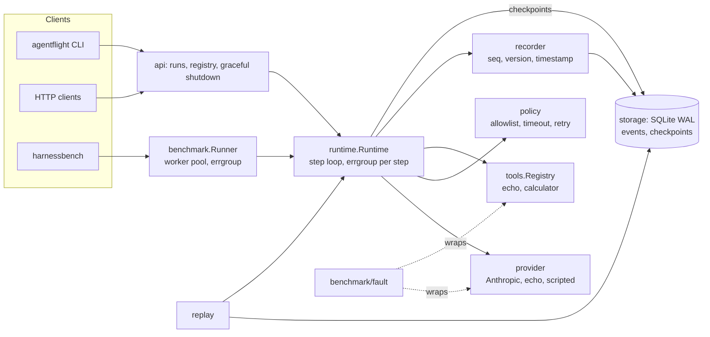

# AgentFlight

AgentFlight is a Go agent runtime that records every step of a run to a
durable event log, so a run can be replayed, resumed after a crash, and
measured against a naive baseline under injected faults. It ships with a
benchmark harness, an HTTP API with graceful shutdown, and profiling hooks.

It runs fully offline by default. No API key is needed for the quickstart.

## Headline result

Fault-injection comparison on the 12-task basic suite, 10 repeats per task per
fault rate, same seeded faults for both runtimes (from
[docs/results.md](docs/results.md)):

| Runtime | Fault rate | Success rate | Mean steps | p95 latency | Duplicate tool execs | Runs with recorded final state |
| --- | --- | --- | --- | --- | --- | --- |
| agentflight | 0.00 | 100.0% | 2.25 | 1.470041ms | 0 | 120/120 |
| baseline | 0.00 | 75.0% | 2.08 | 1.042µs | 0 | 0/120 |
| agentflight | 0.05 | 88.3% | 1.99 | 31.978291ms | 9 | 120/120 |
| baseline | 0.05 | 63.3% | 1.73 | 400.644667ms | 0 | 0/120 |
| agentflight | 0.10 | 78.3% | 1.74 | 33.100417ms | 13 | 120/120 |
| baseline | 0.10 | 52.5% | 1.42 | 400.322541ms | 0 | 0/120 |
| agentflight | 0.20 | 58.3% | 1.30 | 44.592167ms | 24 | 120/120 |
| baseline | 0.20 | 40.8% | 1.07 | 400.736625ms | 0 | 0/120 |

Mid-run kill scenario: AgentFlight's `Resume` recovers 30 of 30 killed runs
with zero duplicate tool executions. Baseline, which restarts from scratch,
recovers 20 of 30, and its 30 restarts re-execute tool calls that had already
completed before the kill (30 duplicate executions).

At 0% faults the baseline passes 9 of 12 tasks, for two different reasons: task-12 fails because baseline aborts on the first tool error (the calculator's divide-by-zero) instead of returning it to the model, a real capability gap, and tasks 09 and 10 fail because they are graded `tool_called`, which reads the event log that baseline does not keep, so they are counted as never called even though baseline made the call, a grading artifact.

The p95 latency column measures how long a run lasted before it ended, and under faults it is set by the harness rather than by either runtime's own behavior. Every run gets the same 400 ms deadline (`perRunTimeout` in `cmd/harnessbench/compare.go`). Baseline has no per-tool timeout, so a hung tool call holds the run until that deadline ends it, which is why its p95 is about 400 ms and is a ceiling, not a measured duration. AgentFlight sets a 30 ms per-tool timeout, so a hung call fails after 30 ms and is retried, and its p95 is about 30–45 ms, roughly one timed-out attempt plus a successful retry. The latency gap is therefore the per-tool timeout, not faster execution; the numbers do not show how long a successful baseline run would take.

The duplicate-execution column for AgentFlight is policy retries after injected
transient faults. Its rise with the fault rate is the cost of retrying, and the
trade is a higher success rate. Baseline never retries, so it cannot duplicate
calls but also cannot recover from transient failures.

## Architecture



The runtime is the only component that drives a run. Everything else plugs
into it through small interfaces: `ModelProvider`, `ToolExecutor`, `Recorder`,
`recovery.Store`, and `policy.Policy`. The SQLite event log is the source of
truth. Replay, resume, grading, and the API's run views are all read from it.

## Quickstart (mock mode, no API key)

```bash
go build ./...
go test ./...

# Start the API on a local SQLite event store, with a 2s mock model latency.
go run ./cmd/agentflight serve --addr 127.0.0.1:8080 --db agentflight.db --mock-latency 2s &

curl -s localhost:8080/healthz
curl -s -X POST localhost:8080/runs -d '{"prompt":"hello"}'     # -> {"id":"…","status":"running"}
curl -s localhost:8080/runs/<id>                                # poll until status is "completed"
curl -s localhost:8080/runs/<id>/events                         # the full event log
curl -s -X POST localhost:8080/runs/<id>/cancel                 # stop a running run
curl -s -X POST localhost:8080/runs/<id>/resume                 # continue from its last checkpoint

kill -TERM %1   # drains: stops accepting requests, cancels active runs, waits for their final state
```

Replay a recorded run and check that it reproduces the same result:

```bash
go run ./cmd/agentflight replay --db agentflight.db <run-id>   # prints OK or the first mismatch
```

Reproduce the comparison table:

```bash
go run ./cmd/harnessbench compare --suite benchmarks/basic.jsonl \
  --faults 0,0.05,0.1,0.2 --repeats 10 --report docs/results.md
```

Run a suite and get per-execution results plus a summary report:

```bash
go run ./cmd/harnessbench run --suite benchmarks/basic.jsonl --concurrency 8 --repeats 3 \
  --out results.json --report report.md
```

Profile a run with `--pprof 127.0.0.1:6060` on either CLI. See
[docs/performance.md](docs/performance.md) for the profiling workflow and the
findings.

## Using MCP tools

Tools served by a [Model Context Protocol](https://modelcontextprotocol.io)
server can be registered alongside the built-in tools. Each server tool
becomes a `tools.Tool`, so the runtime, policy (allowlist, per-tool timeout,
retries), and recording treat it like any other tool.

```go
session, err := mcp.ConnectStdio(ctx, exec.Command("my-mcp-server", "--flag"))   // stdio
// or: session, err := mcp.ConnectHTTP(ctx, "https://host/mcp", nil)            // streamable HTTP
if err != nil { /* ... */ }
defer session.Close()

reg := tools.NewRegistry()
names, err := mcp.Register(ctx, reg, session)   // one Tool per server tool, paginated
```

Run the example, which starts a demo MCP server as a subprocess and runs an
agent against its `add` tool. It needs no network and no API key:

```bash
go run ./examples/mcp
# connected over stdio; server offers tools: [add]
# agent answer (2 steps): 2 + 3 = 5
```

Error mapping: a deadline that expires during a call is `policy.ErrToolTimeout`
(retried); a broken connection is `policy.ErrTransient` (retried); a tool that
reports an error in its result is `mcp.ErrToolReported`, and JSON-RPC protocol
errors are terminal.

Against a real third-party server, the same adapter lists and calls tools from
`@modelcontextprotocol/server-filesystem`. Use a throwaway directory:

```bash
go run ./examples/mcp-filesystem -dir /tmp/mcp-sandbox \
  -pkg @modelcontextprotocol/server-filesystem@<version>
```

The MCP SDK is confined to `internal/tools/mcp`. `make vet` fails if any other
package imports it, as required by [AGENTS.md](AGENTS.md).

## Go features and where to find them

| Feature | Where |
| --- | --- |
| Bounded worker pool with `errgroup` and an ordered results channel | [internal/benchmark/runner.go](internal/benchmark/runner.go) |
| Per-step fan-out of tool calls, waiting for every goroutine to exit | [internal/runtime/runtime.go](internal/runtime/runtime.go) (`runToolCalls`) |
| Context cancellation at step boundaries, with detached final writes | [internal/runtime/runtime.go](internal/runtime/runtime.go) (`finishCancelled`, `record`) |
| Per-run goroutines in a mutex-guarded registry | [api/registry.go](api/registry.go), [api/server.go](api/server.go) (`launch`) |
| `signal.NotifyContext` graceful shutdown with a deadline | [api/serve.go](api/serve.go), [cmd/agentflight/serve.go](cmd/agentflight/serve.go) |
| Go 1.22 method-and-path routing with `r.PathValue` | [api/server.go](api/server.go) (`Handler`) |
| Typed sentinel errors with `errors.Is` / `errors.As` | [runtime/errors.go](internal/runtime/errors.go), [policy/policy.go](internal/policy/policy.go), [metrics/errors.go](internal/metrics/errors.go) |
| Small consumer-side interfaces | [runtime/runtime.go](internal/runtime/runtime.go) (top of file), [recovery/checkpoint.go](internal/recovery/checkpoint.go) |
| Optional capability via interface assertion (`SeqStore`, `retryCounter`) | [recorder/recorder.go](internal/recorder/recorder.go), [runtime/runtime.go](internal/runtime/runtime.go) |
| Pure-Go SQLite (no cgo), WAL mode, append-only triggers | [storage/sqlite.go](internal/storage/sqlite.go), [migrations/001_init.sql](migrations/001_init.sql) |
| `encoding/json` with custom (un)marshalling | [benchmark/types.go](internal/benchmark/types.go) |
| Streaming JSON output through `json.Encoder` | [cmd/harnessbench/results.go](cmd/harnessbench/results.go) |
| Structured logging with `log/slog` | [api/server.go](api/server.go), [runtime/runtime.go](internal/runtime/runtime.go) (`WithLogger`) |
| Seeded, reproducible fault injection | [benchmark/fault/fault.go](internal/benchmark/fault/fault.go) |
| Fuzzing with a seed corpus from real recorded events | [recorder/fuzz_test.go](internal/recorder/fuzz_test.go), [replay/fuzz_test.go](internal/replay/fuzz_test.go) |
| Benchmarks, including with and without SQLite | [recorder/bench_test.go](internal/recorder/bench_test.go), [runtime/bench_test.go](internal/runtime/bench_test.go), [benchmark/runner_bench_test.go](internal/benchmark/runner_bench_test.go) |
| `net/http/pprof` on an explicit mux | [pprofserve/pprofserve.go](internal/pprofserve/pprofserve.go) |
| Real-signal test of graceful shutdown | [api/shutdown_test.go](api/shutdown_test.go) |
| MCP client over stdio and HTTP, mapped to typed errors | [tools/mcp/tool.go](internal/tools/mcp/tool.go), [tools/mcp/connect.go](internal/tools/mcp/connect.go) |
| Race-clean concurrency tests, repeated for flakes | [benchmark/runner_test.go](internal/benchmark/runner_test.go), [runtime/recovery_test.go](internal/runtime/recovery_test.go) |

## Design decisions

**The event log is the source of truth.** Every model request and response,
tool call and result, policy decision, checkpoint, and run boundary is an
append-only row in SQLite. Replay, resume, grading, and the API's run views
all read that log, so they cannot disagree with what actually happened.
Triggers reject `UPDATE` and `DELETE` on `events`.

**Cancellation is observed at step boundaries, and final writes are not
cancellable.** The loop checks `ctx` before each provider call and tool call.
Event writes use `context.WithoutCancel`, so a cancelled run still records
its checkpoint and `run_finished` with status `cancelled`. Without that, a
cancel that lands mid-write could leave a run with no final state at all. A
regression test caught this case and drove the fix.

**Resume reuses recorded results rather than re-executing.** On resume the
runtime scans the log for tool results already recorded for the step it is
re-attempting, and uses them instead of calling the tool again. That is why
AgentFlight shows zero duplicate tool executions in the kill scenario.

**Sequence numbers survive restarts.** A recorder created after a restart asks
the store for the run's last sequence number before it writes, so resuming a
run continues its log instead of colliding with it. The fix came from a test
that reproduced a unique-constraint failure after a simulated restart.

**Retries and timeouts sit in a policy, not in the runtime.** `DefaultPolicy`
enforces a tool allowlist, a per-tool timeout, and exponential backoff with
jitter, and classifies errors as retryable or terminal. Each error type is
classified by `errors.Is`/`errors.As`, never by matching message text. Backoff
waits use a timer and `select` on `ctx.Done`, so cancellation interrupts them.

**The API owns run lifecycle, not the runtime.** Each run gets its own
goroutine and a context derived from `context.Background`, so it outlives the
HTTP request that started it. A mutex-guarded registry tracks active runs and
their cancel functions. A run the process no longer knows about is reported
from the event log, as `interrupted` if it never finished.

**Shutdown has a fixed order.** On `SIGINT` or `SIGTERM` the server first
stops accepting requests, then cancels active runs, then waits up to a
deadline for each run to record its final state. It exits non-zero if any
run is still active at the deadline. The shutdown test sends a real `SIGTERM`
to the test process and checks that the run's final event is `cancelled`.

**Dependencies are kept to a short allow-list.** Beyond the standard library,
the allowed modules are `golang.org/x/sync/errgroup`, `modernc.org/sqlite` (pure
Go, no cgo), and the official MCP Go SDK, pinned in `go.mod`. The SDK may be
imported only from `internal/tools/mcp`, and `make vet` enforces that. The rule
is written down in [AGENTS.md](AGENTS.md).

**Benchmarks measure what they claim.** The fault injector is seeded, so both
runtimes see the same faults and the comparison is reproducible. Recording
overhead is measured with and without SQLite. Profiling found that per-event
SQLite commits dominate CPU, and the write-up in
[docs/performance.md](docs/performance.md) keeps the findings that were not
fixed alongside the ones that were.

## Status and limits

- The provider is an offline echo mock, or the Anthropic client in
  [internal/provider/anthropic.go](internal/provider/anthropic.go), which
  needs `ANTHROPIC_API_KEY`. The live client is tested against `httptest`, not
  the real API.
- The per-event SQLite commit is the main cost of recording. Batched group
  commit is the recommended next step, described in
  [docs/performance.md](docs/performance.md).
- MCP tools work over stdio and streamable HTTP. The test suite uses
  in-process fake servers. Stdio was also checked against a real third-party
  server, `@modelcontextprotocol/server-filesystem`, run unpinned (the latest
  release at the time, 2.0.1). It listed 14 tools and returned a file's
  contents through `read_text_file`. HTTP has not been checked against a
  third-party server.
